# Nuvora Core 0.15.0

Nuvora Core 是自研实验操作系统。x86-64 版本提供 UEFI/BIOS 启动、Loom 命令环境、图形桌面、自有数据卷和基础驱动；ARM64 版本目前是独立的引导与 EL0 计算基线。项目尚未完成实体机兼容认证。

0.15.0 默认进入图形登录与桌面。本轮重做工作区：深海色弧线背景、清晰的大标题、靠左应用栏，以及可直接打开 Files、Terminal、Settings 的三个入口。提供 Tide、Glacier、Ember 三种配色；大标题随高分屏缩放，图标和圆角均由原生程序绘制。Apps 搜索、窗口总览、平铺、多账户与偏好保存继续可用。

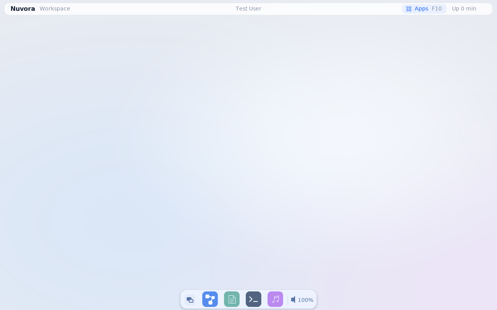

Files 提供文件卡片、搜索、排序和详情；Music 提供真实播放列表与共享音量；设置包含外观、声音、网络、安全和系统五页。浮动窗口统一裁剪四角，透明角落可点击后方窗口，最大化和平铺使用直角。内核继续执行账户隔离、自动锁屏和管理员权限；行为与准确边界见[桌面与安全](docs/DESKTOP-SECURITY.md)。

Terminal 现在随窗口宽高调整字符行列，最大化、半屏和还原会重排已有输出，
保持字号和输入位置。最大化使用整个工作区，底部应用栏保留；旧原生应用的
80×25 字符接口保持兼容。以下是 1920×1080 正式系统的实际截图：

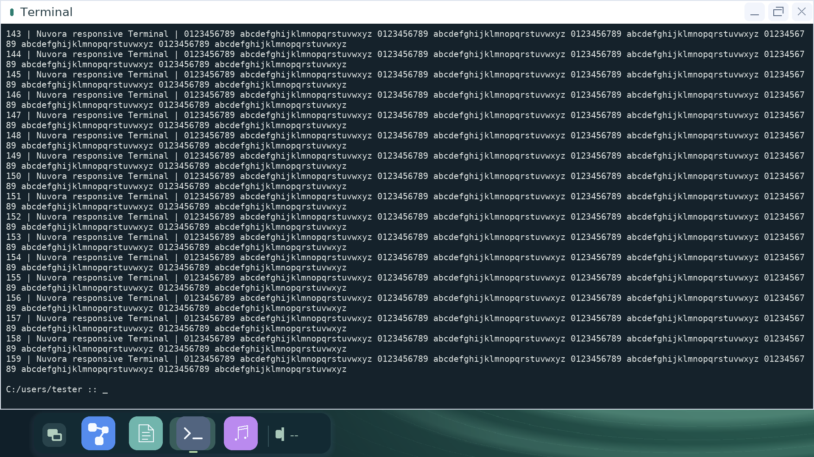

QEMU 可指定客体分辨率并全屏启动，例如
`python3 start.py --uefi --fullscreen --resolution 1920x1080`。
Windows 使用 `./start.ps1 run -Uefi -Fullscreen -Resolution 1920x1080`。
分辨率在启动时确定；运行中拖动模拟器外层窗口尚不会切换客体显示模式。
多分辨率验证与重拍步骤见[测试说明](docs/TESTING.md)。

保留 0.14.0 的原生 64 位 ABI：代码、栈、堆及图形/音频缓冲可使用 4 GiB 以上地址，兼容旧 ABI 1 ELF64 二进制。实体 PC 使用 FAT32 UEFI 启动介质、GOP 模式回退、按设备能力选择的 DMA 地址及 ACPI 电源路径；本版修正 UEFI ACPI 1.0 表 GUID，并优先选择 ACPI 2.0。上机步骤与准确边界见[实体机与 64 位说明](docs/NATIVE64-HARDWARE.md)。

## 桌面语言与 Minecraft 兼容路线

其他系统的兼容实现、工具、夹具与测试统一放在 [`compat/`](compat/README.md)。
原生桌面、文件系统和驱动直接使用 Nuvora 接口。可以用
`make COMPAT=none -j4 diagnostics esp` 构建完全关闭 Linux 后端的版本，
再运行 `python3 start.py --compat none --uefi --window`；Windows 对应
`./start.ps1 run -Compat none -Uefi -Window`。两种配置使用独立构建目录。

Linux x86-64 兼容层已在 Nuvora 用户态实际运行 **musl C、C++ 核心语法、
Lua 5.4.8、QuickJS、MicroPython 1.26.1 和真正的 OpenJDK 21.0.11 / HotSpot**。Terminal 使用
`compat /home/lua.elf /home/world.lua` 或 `compat /home/js.elf /home/world.js`；
导入、构建与准确边界见 [运行时说明](compat/docs/RUNTIME.md)。

Python 已验证模块导入、继承、生成器、中文字符串、大整数、浮点、JSON/正则、
垃圾回收和文件持久化。同一示例与 CPython 输出一致；**这仍是 MicroPython，
不代表完整 CPython、pip 或第三方桌面库可用**。

```text
compat /home/python.elf /home/world.py "hello world"
```

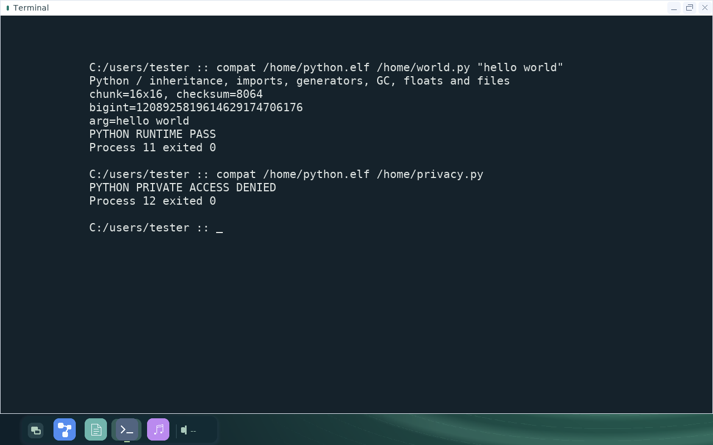

真实 OpenJDK 已通过 `java -version`、JAR 加载、4 个 Java 工作线程、同步、
BigInteger、SHA-256、NIO 文件与目录流、安全随机数、时钟与 GC。HotSpot 还实际编译并执行了
测试方法，20 万轮结果通过校验；重复 JVM 退出后物理内存计数完全一致。
可选安装步骤、启动参数与限制见[运行时说明](compat/docs/RUNTIME.md)。

```text
compat --jit /home/jdk/bin/java @/home/java-check.args
compat --jit /home/jdk/bin/java @/home/java-jit.args
```

正式 UEFI Terminal 中运行真实 OpenJDK，账户库读取被拒绝，Java 程序正常退出并保存文件：

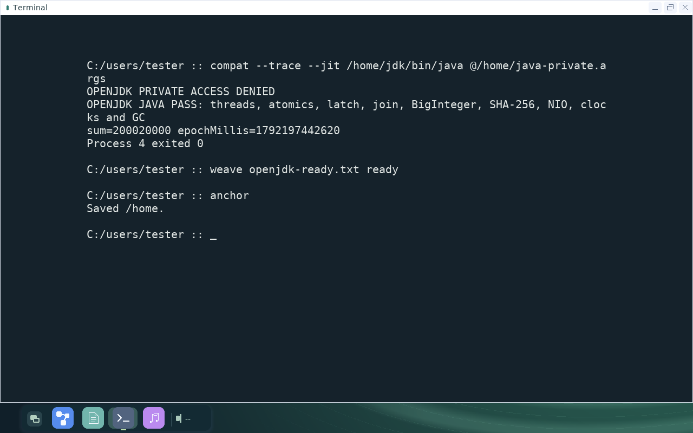

目标为 **Minecraft Java 1.20.1 及以上**，目前用官方 1.20.1 和 1.21.1 客户端
建立真实启动探测。已修复 Java 自重启参数过短、16 个文件句柄不足和 VMA 耗尽
等问题；目录流与安全随机数接口通过真实 Java 验证。
**目前 Minecraft 仍不能玩**：尚未通过进入世界、画面、操作和保存验收，
LWJGL/GLFW、OpenGL/OpenAL、Linux socket、硬件信息探测与完整资源仍待完成。
可复现工具及实际结果见[运行时说明](compat/docs/RUNTIME.md)。
此次验证限定 Alpine musl x86-64 JDK 21，不能推断全部新版游戏或 Java 版本兼容。
现有 `java` 命令保留 bootstrap，完整 JVM 使用上述路径。

正式 UEFI 桌面中运行真实 C++、Lua 和 JavaScript（QMP 原始帧缓冲）：

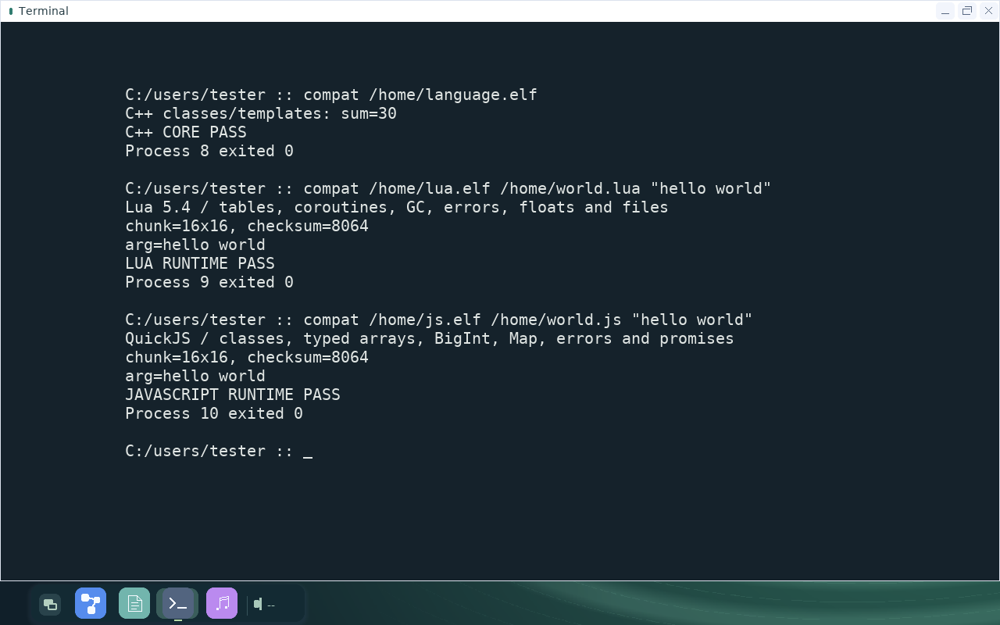

C 运行库、内存、TLS 与受保护账户数据访问检查：

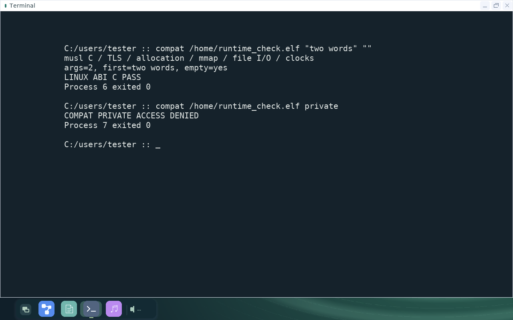

使用 `python3 compat/tests/compat_desktop_test.py` 重拍；哈希与构建来源见
[截图清单](docs/screenshots/compat-manifest.json)。

## Java 21 兼容进度

新增实验性 Java 字节码解释器，在 Terminal 输入 `java --demo "hello world"`，
或用 `java -cp /home MultiMain` 运行多类程序。现在支持目录类路径、最多 16 个
应用类、跨类对象与方法、按需静态初始化、整数/长整数、数组和基础字符串；
真实输出与 OpenJDK 21 比对。
本段说明既有 bootstrap 回归入口；真实 OpenJDK 进度见上一节。
当前边界、编译导入步骤和 Minecraft 路线见 [Java 说明](docs/JAVA.md)。

正式系统中的 Java 21 多类程序运行画面（实际 Terminal 帧缓冲）：

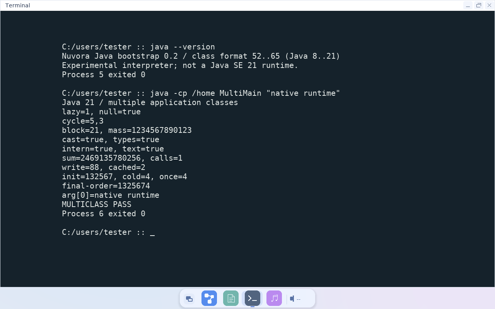

可用 `python3 tests/java_desktop_test.py` 重拍，校验值见
[Java 截图清单](docs/screenshots/java21-multiclass-manifest.json)。下面是本轮重新拍摄的桌面回归截图。

## 运行截图

此前已增加原生静态 PIE 应用支持：常规 ELF 布局、相对指针重定位、只读
重定位区和现有 SPAWN/EXEC 接口；运行 `forge pie` 可查看实际示例，开发
步骤见 [SDK](docs/SDK.md)。共用内存复制、清零和重叠搬移改为有界标量字
操作，性能测量与验证边界见[测试记录](docs/TESTING.md)。此前编辑器、
账户、锁屏和网络修复均已保留，安全边界见[安全审查](docs/SECURITY-REVIEW.md)。

以下图片来自正式 x86-64 系统在 QEMU/OVMF 中的实际运行：UEFI USB 启动、
256 MiB 内存、AHCI 数据盘、USB 键盘/鼠标、e1000e 网卡和 HDA 声音。
直接截取客体帧缓冲并无损
转换为 PNG，未合成界面；这是模拟 PC 的运行结果。

Apps 支持搜索、方向键和鼠标启动。按住已打开窗口的标题栏，拖到顶栏 Apps
显示「Pin to Apps」时松手，即可固定对应的系统应用；窗口恢复原来的大小和位置。
固定应用优先显示并带绿色标记；选中后按 Ctrl-P，或右键点击应用卡片，可取消固定。
固定记录按账户保存，有数据盘时同步到磁盘，重启后保留。拖动时按 Esc 可取消。

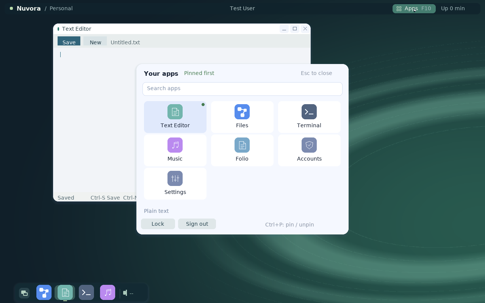

将窗口拖到 Apps 时会显示松手固定提示：

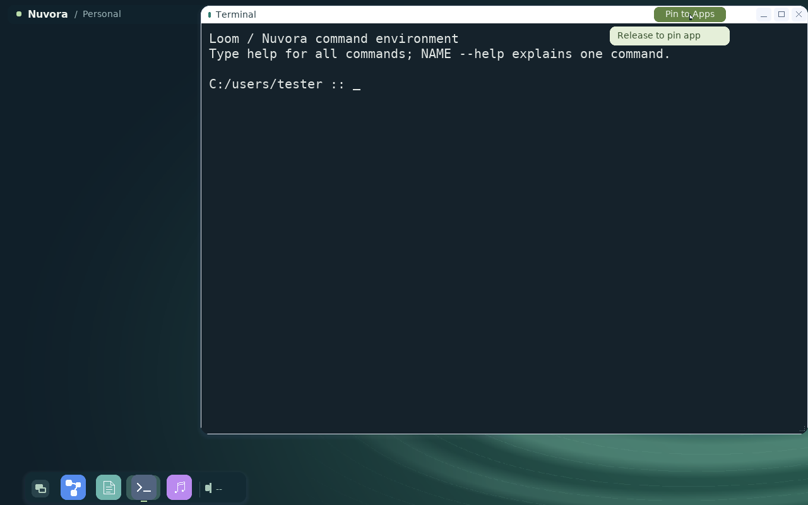

应用栏音量浮层：点击标题保持打开，滑块支持实际音量拖动；圆角外点击关闭。

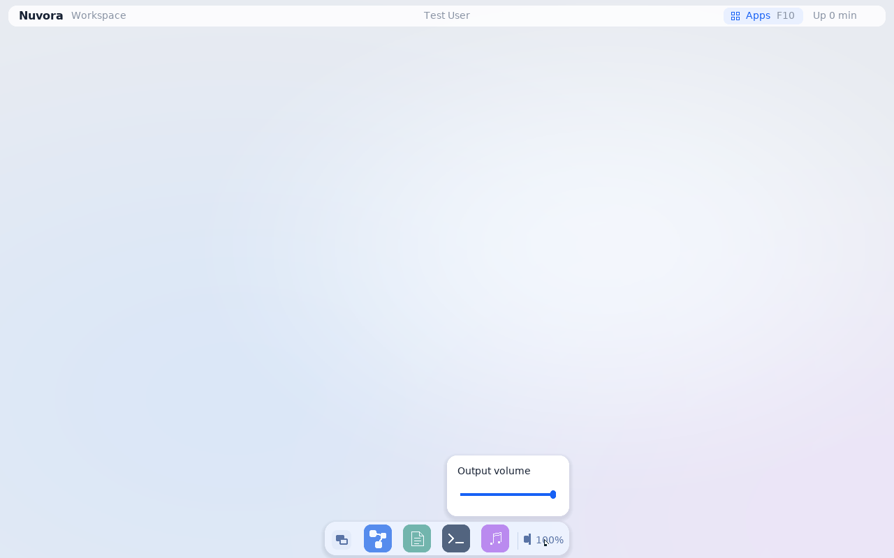

保存数据卷后的圆角通知，六秒后自动消失：

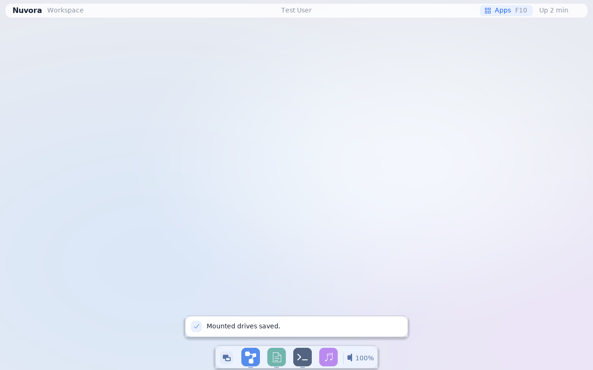

Files 文件管理器：白色导航、蓝色文件图标、卡片网格和选中项详情。

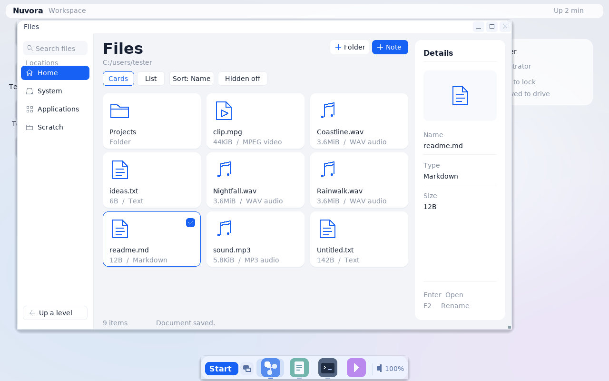

Music 音乐播放器：原生播放列表、圆形播放控制和共享输出音量。

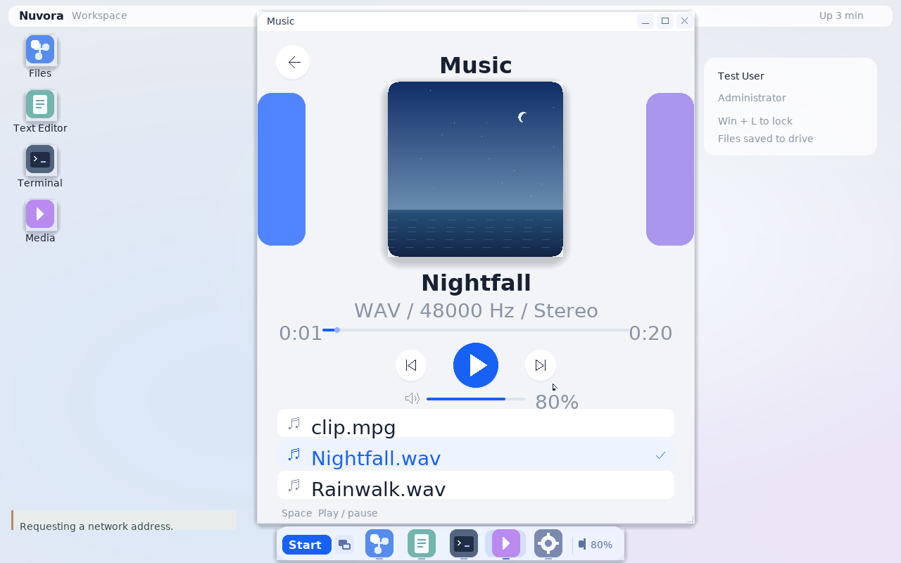

默认封面由程序绘制，示例音轨是测试脚本创建的真实 WAV 文件。WAV/FLAC
显示实际时长，无法确定时长的格式显示 `--:--`；列表和播放信息来自打开的文件。

Files 与 Terminal 并排显示，终端查看系统版本、内存和数据卷：

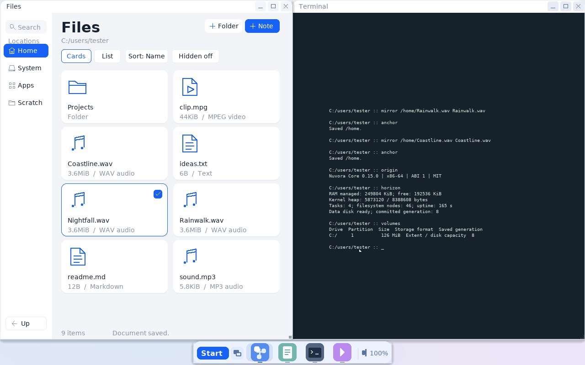

Text Editor 编辑并保存到数据卷，Files 显示已保存的文档：

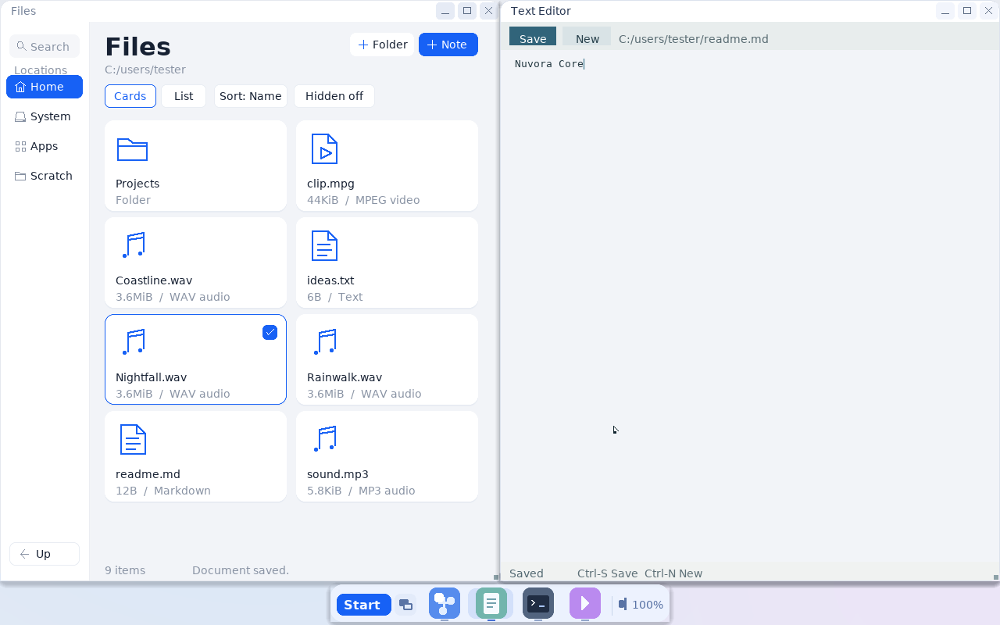

设置中心的外观与文件视图偏好：

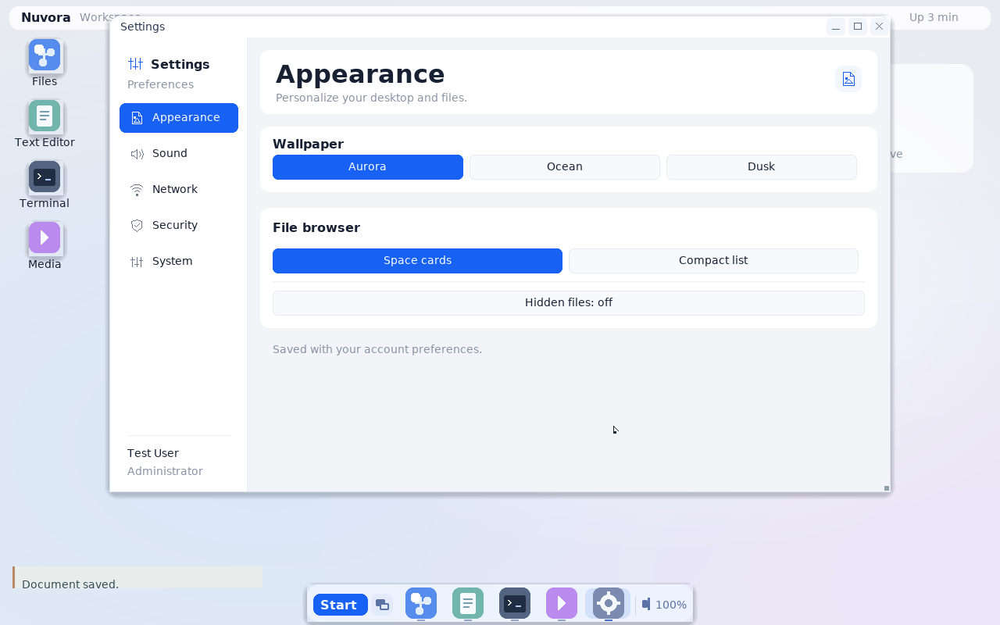

实际 HDA 输出音量和网络地址：

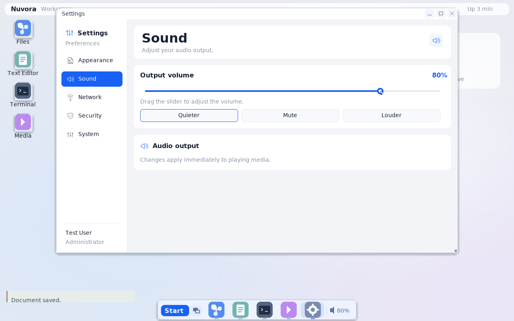

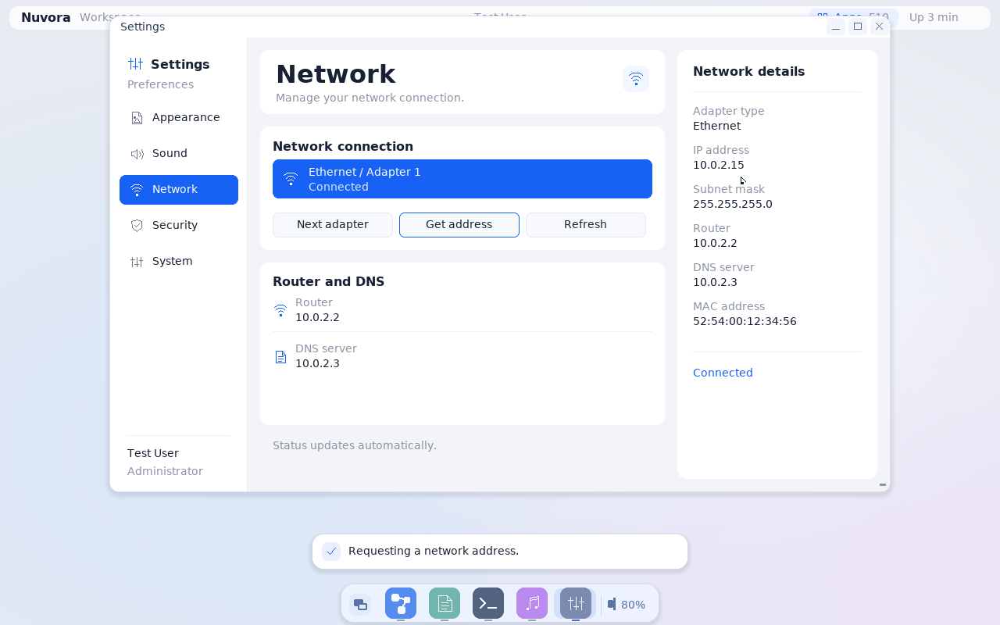

构建后运行 `python3 tests/capture_screenshots.py` 可重新拍摄；脚本使用
临时启动介质和数据盘，并核验编辑器、文件搜索打开、播放器切歌/暂停/恢复、
HDA 双声道波形、共享音量、音量浮层命中与拖动、通知自动消失和 DHCP 操作。十一张截图均来自客体实际运行。
截图和构建镜像的校验值见[截图清单](docs/screenshots/manifest.json)。

## 实体机启动

在 Linux 构建机安装 GCC、binutils、Python 3 和 mtools 后：

```sh
make -j4 all
make test-host
make media
```

将 `build/x86_64/nuvora-uefi-media.img` 写入专用测试 U 盘，在目标 PC 的
x64 UEFI 启动菜单选择它，并关闭 Secure Boot。镜像使用 FAT32 ESP，
不会自动安装或分区；写盘与存储要求见 [启动介质](docs/BOOT-MEDIA.md)。

## 开发环境快速运行

Ubuntu 或 Arch Linux 宿主安装 GCC、binutils、Python 3、QEMU、OVMF 和 mtools 后：

```sh
make -j4
make esp
python3 start.py --uefi --window --audio
```

`start.py` 默认创建 **8 GiB 稀疏 GPT 数据镜像**，保留已有镜像；`--disk-size` 以 MiB 指定新镜像容量，`--partitions 2` 可在首次建盘时生成 C:、D: 两卷。选择存储总线：

```sh
python3 start.py --uefi --window --disk-bus ahci
python3 start.py --uefi --window --disk-bus nvme
```

Arch Linux 安装依赖使用 `sudo pacman -Syu --needed gcc binutils make python git qemu-desktop edk2-ovmf mtools xorriso`。启动脚本自动识别 Arch 的 OVMF 固件布局，步骤见 [Arch Linux 指南](docs/ARCH-LINUX.md)。

Windows 10/11 在 PowerShell 中运行 `./start.ps1 doctor`、`./start.ps1 build`、`./start.ps1 run -Uefi -Window`，默认使用 WSL2 工具链。详细依赖、ISO 与独立 UEFI 启动介质见 [Ubuntu 指南](docs/UBUNTU.md)、[Windows 指南](docs/WINDOWS.md)和[启动介质](docs/BOOT-MEDIA.md)。

## 当前功能

| 范围 | 状态 |
| --- | --- |
| 内存 | x64 四级页表支持低半规范用户地址（最高 128 TiB），原生堆从 64 GiB 起、上界 64 TiB；最多管理 128 GiB 物理地址范围、2048 个启动内存图条目；按设备能力选择 DMA 范围；ARM64 上限仍为 64 GiB |
| 数据盘 | IDE、SATA/AHCI 的 512B 与 512e 盘（LBA28/LBA48），以及 512B NVMe namespace；按活动命名空间列表识别稀疏编号，旧控制器回退顺序枚举 |
| 文件 | GPT 默认一个 Nuvora 卷；NVSTORE3 支持 64 位文件大小、稀疏块和双元数据根；旧 NVSTORE1/2 可读取，解除旧容量限制需迁移 |
| 桌面与媒体 | 浅色蓝白 Files 卡片/紧凑列表、搜索、排序与详情；五页设置及用户偏好恢复；三种壁纸、顶部 Apps、居中应用面板、紧凑应用栏、圆角通知与窗口；应用搜索、总览、最近使用切换、贴边平铺及局部重绘；Text Editor、Terminal、Music、Folio；共享音量、播放列表与切歌，流式播放 MP3/MP2/FLAC、WAV/RF64 和 MPEG-1/MP2 视频 |
| 账户与安全 | 图形 OOBE、登录、内核自动锁屏、退出登录；管理员/普通账户、密码修改、禁用和删除；独立用户目录、持久密码散列；管理员电源/网络配置权限，生产内核禁用测试认证绕过 |
| 外设与网络 | xHCI Boot 键盘/鼠标（含数字小键盘）、USB CDC-ECM 和基础 RNDIS 共享网络、部分 Intel 有线网卡；特定 ESP USB Dongle 固件提供 Wi-Fi 桥接；IPv4 `ping`、DNS、HTTP `wget` |

首次启动创建管理员账户，后续用密码登录。Apps → Accounts 管理用户；Win-L 锁屏，Apps → Sign out 退出登录。Apps → Settings 调整壁纸、文件视图、输出音量和 1/5/15 分钟自动锁屏，查看网卡、内存与运行时长；管理员可请求 DHCP 地址、重启或关机。默认 5 分钟无输入由内核锁定。壁纸、文件视图/排序/点文件显示、音量和锁屏选择随用户数据卷保存，兼容原来的壁纸/锁屏偏好。账户密码要求 15–128 个字符；访问与安全边界见[账户说明](docs/ACCOUNTS.md)。

点击顶部 Apps，或按 Win/Super、F10 打开应用面板；空桌面按 Enter 也可打开。输入应用名称或 `mp3`、`video` 等关键词搜索，左右键移动一项，上下键按网格跨行，Enter 启动。Win-Tab 或 F12 打开窗口总览；Alt-Tab 按最近使用顺序选择，松开 Alt 切换，Shift 反向、Esc 取消。Win-左右平铺，Win-上最大化，Win-下恢复/最小化；标题栏拖到边缘也可平铺。Alt-F4/F9/F10 分别关闭、最小化、最大化/恢复。播放或下载时可操作其他窗口；Folio 关闭前保留未保存提示。应用栏和播放器可调输出音量。

Files 默认以类型卡片展示文件，宽窗口显示选中项详情；Ctrl-F 搜索当前目录，Ctrl-1/2 切换卡片/列表，F8 在名称、类型与大小排序间切换，Ctrl-H 显示点文件。可以新建、改名和删除；`.txt`/`.md` 在 Text Editor 中编辑，`.nvd` 在 Folio 中编辑，支持的音视频在 Music 中打开。播放器支持点击列表或左右方向键切歌、Space 暂停/继续，暂停时也同步设置页的音量。终端包含完整命令集，输入 `exit` 关闭窗口；`volumes`、`partitions` 查看卷，`anchor` 提交文件改动。桌面文件操作与编辑器保存会尝试自动提交。详情见[命令](docs/COMMANDS.md)、[网络](docs/NETWORK.md)和[设备范围](docs/DEVICES.md)。

## 构建与验证

```sh
make -j4 all
make test-host
make iso-uefi   # 需要 mtools 和 xorriso
make media      # 生成 GPT/ESP 启动镜像，不写宿主磁盘
```

当前通过 50 组宿主回归，包括 Linux ABI/真实语言运行时、Java 21 多类加载/初始化/损坏输入/资源上限、内存操作边界、静态 PIE/RELRO、编辑器文件保护、锁屏输入/显示撤权、随机字节 ABI、网络进程归属与报文校验、原生高地址页表/ELF/堆、账户权限/自动锁屏、界面边界、共享图标、媒体路径、ACPI 电源解析和高地址 DMA。实际启动与桌面测试范围见[测试说明](docs/TESTING.md)。图形输出使用 GOP 软件帧缓冲，壁纸缓存与分块重绘减少输入等待；尚无 GPU 加速或实体机桌面认证。

目前只挂载 Nuvora 自有格式，**不会格式化或写入普通 Windows/Linux 分区**。4Kn 逻辑扇区、USB 存储挂载、笔记本内置 PCI Wi-Fi、USB NCM、VirtIO/SCSI、Secure Boot、多核和 Linux/POSIX 应用兼容尚未实现。完整边界与历史变更见[测试说明](docs/TESTING.md)、[架构](docs/ARCHITECTURE.md)、[路线图](docs/ROADMAP.md)和[更新记录](docs/CHANGELOG.md)。

## 许可

原创代码采用 MIT。打包的第三方组件及许可见 [third_party](third_party/README.md)；技术资料见[资料列表](docs/SOURCES.md)。
